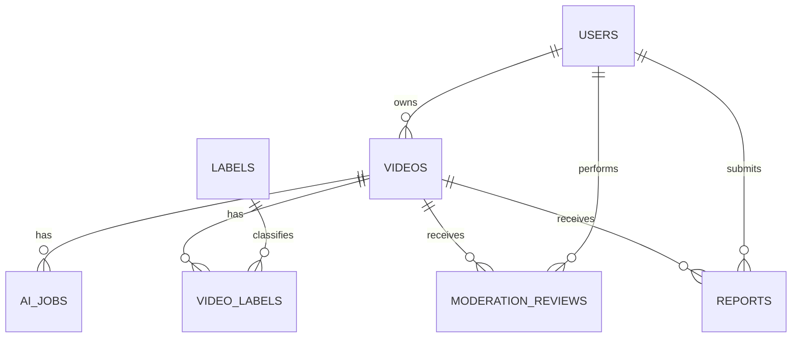
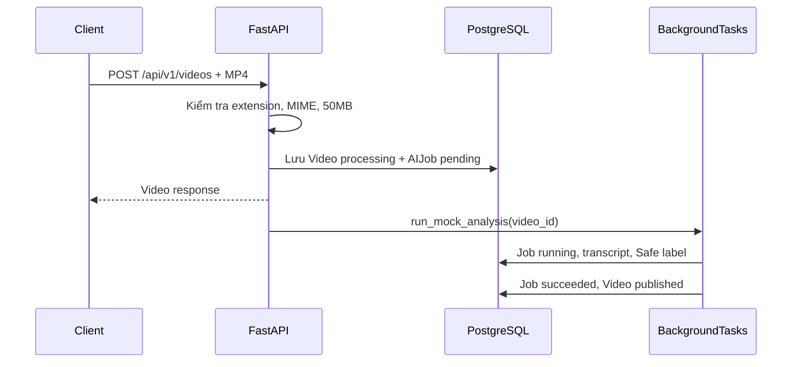

# Báo cáo kỹ thuật triển khai PBL6

**Dự án:** PBL6 — AI Short Video Moderation  
**Phạm vi:** Backend MVP, PostgreSQL, API, xác thực, xử lý AI mô phỏng và
moderation cơ bản  
**Thời điểm khảo sát:** 25/10/2026  
**Nguyên tắc:** Báo cáo chỉ ghi nhận những gì có code, cấu hình, kết quả lệnh
hoặc schema database có thể kiểm tra được.

## Mục lục

1. [Tổng quan tiến độ](#1-tổng-quan-tiến-độ)
2. [Chi tiết từng công việc](#2-chi-tiết-từng-công-việc)
3. [Database PostgreSQL](#3-database-postgresql)
4. [API và Backend](#4-api-và-backend)
5. [Test, debug và sửa lỗi](#5-test-debug-và-sửa-lỗi)
6. [Tài liệu, cấu hình và cách chạy](#6-tài-liệu-cấu-hình-và-cách-chạy)
7. [Đối chiếu SRS](#7-đối-chiếu-srs)
8. [Công việc còn lại](#8-công-việc-còn-lại)
9. [Kết luận và bàn giao](#9-kết-luận-và-bàn-giao)

## 1. Tổng quan tiến độ

### 1.1. Trạng thái hiện tại

Workspace tại `E:\PBL6` hiện có một Backend MVP FastAPI. Repository local không
chứa thư mục `.git`; các lệnh `git status`, `git diff` và `git log` đều trả về
`fatal: not a git repository`. Vì vậy không thể xác minh Git diff, commit local,
tác giả commit hoặc lịch sử thay đổi bằng Git.

Repository GitHub ban đầu đã được khảo sát trước khi triển khai. Tại thời điểm
đó repository chỉ có `README.md` tối thiểu và `.gitignore`, chưa có Backend,
models, migration, dependency manifest hoặc test. Các file hiện tại là thay
đổi cục bộ trong workspace; chưa có bằng chứng chúng đã được commit hoặc push.

Các công nghệ được xác nhận từ code:

- **FastAPI:** khai báo ứng dụng, endpoint REST, OpenAPI/Swagger và
  `BackgroundTasks`.
- **SQLAlchemy 2.x:** khai báo models bằng `DeclarativeBase`, `Mapped` và
  `mapped_column`, tạo engine và session.
- **PostgreSQL + psycopg:** database chạy thực tế là PostgreSQL 18.6; driver
  `psycopg[binary]` nằm trong dependency manifest.
- **Alembic:** migration `0001_initial` và bảng `alembic_version`.
- **Pydantic v2 / pydantic-settings:** request/response schemas và đọc `.env`.
- **PyJWT:** tạo và giải mã access token JWT.
- **Python `hashlib.scrypt`:** băm mật khẩu với salt ngẫu nhiên.
- **Pytest + FastAPI TestClient:** test API nền tảng dùng SQLite tạm thời.

Kiến trúc thực tế hiện tại là một ứng dụng đơn giản gồm `main.py` làm API
entry point, `models.py` làm persistence model, `schemas.py` làm validation,
`dependencies.py` làm authentication/RBAC, `security.py` làm hashing/JWT,
`services.py` làm mock AI và `db.py` làm SQLAlchemy session. Chưa có router,
repository hoặc service layer tách riêng cho từng module.

### 1.2. Bảng tổng hợp công việc

| STT | Nhóm công việc | Công việc cụ thể | Kết quả thực tế | Trạng thái | Bằng chứng |
|---:|---|---|---|---|---|
| 1 | Khảo sát | Đọc prompt, SRS và repository GitHub | Xác định repository ban đầu gần như rỗng; SRS có 20 use case và yêu cầu AI/moderation | Đã thực hiện | Prompt/SRS đã truy cập; repository root chỉ có README và `.gitignore` |
| 2 | Foundation | Tạo cấu trúc FastAPI, settings, SQLAlchemy session | Có app, config, engine và dependency database | Đã triển khai | `backend/src/app/main.py`, `core/config.py`, `db/session.py` |
| 3 | Database | Tạo models, Alembic migration và index | 7 bảng nghiệp vụ + `alembic_version` tồn tại trong PostgreSQL | Đã triển khai và xác minh | `0001_initial`; `alembic current`; live schema inspection |
| 4 | PostgreSQL | Kết nối database local `pbl6_db` | Kết nối thành công bằng user `postgres` | Đã kiểm thử thành công | `scripts.check_db`, PostgreSQL 18.6 |
| 5 | Authentication | Register, login, JWT, profile | Có đăng ký, đăng nhập và bảo vệ profile | Đã triển khai; test một phần | `main.py`, `security.py`, `dependencies.py`; test pass |
| 6 | Authorization | Role enum và dependency kiểm tra role | Queue/decision moderation giới hạn Moderator/Admin | Đã triển khai; chưa kiểm thử đầy đủ | `UserRole`, `require_roles` |
| 7 | Video | Upload MP4 tối đa 50MB, local storage, metadata | Có lưu file và record `videos` | Đã triển khai; kiểm thử giới hạn | `upload_video`; test dùng file giả |
| 8 | AI | Background mock AI/STT, label Safe, confidence | Job chuyển running/succeeded, transcript mock, publish video | Đã triển khai mô phỏng | `run_mock_analysis`; chưa có AI thật |
| 9 | Reports | Tạo report và chống report trùng user/video | Có report mở và chuyển video published về pending review | Đã triển khai; test một phần | `create_report`; duplicate report test |
| 10 | Moderation | Queue, quyết định video, xử lý report | Có endpoint Moderator/Admin | Đã triển khai; chưa có test trực tiếp | `moderation_queue`, `moderation_decision`, `report_decision` |
| 11 | Tài liệu | README PostgreSQL, migration, Docker và chạy Backend | Có hướng dẫn Windows/PowerShell và Docker Compose | Đã triển khai | `README.md`, `docker-compose.yml` |
| 12 | Kiểm thử | Compile, pytest, live migration/schema inspection | 3 test pass; migration live ở head | Đã kiểm thử thành công một phần | Output pytest, Alembic và schema inspection |

### 1.3. Mức độ hoàn thành theo nhóm

Không gán tỷ lệ phần trăm vì chưa có tiêu chí đo lường hoàn chỉnh. Đánh giá
định tính:

| Nhóm | Đánh giá dựa trên bằng chứng |
|---|---|
| Phân tích yêu cầu | Đã thực hiện cho phạm vi MVP; SRS đầy đủ đã đọc trước khi code |
| Kiến trúc | Có kiến trúc tối thiểu chạy được; chưa tách module theo quy mô production |
| Database | Model, migration và schema live đã đồng bộ ở revision đầu |
| PostgreSQL | Đã kết nối và áp dụng migration vào `pbl6_db` |
| Backend foundation | Có FastAPI, settings, SQLAlchemy, Alembic và health endpoint |
| Authentication | Có register/login/JWT/profile; refresh/revoke/reset password chưa có |
| Video | Có upload `.mp4`, giới hạn 50MB, local storage, soft delete |
| AI processing | Chỉ có mock AI/STT; chưa tích hợp model hoặc provider thật |
| Moderation | Có queue/decision cơ bản; chưa có claim lock, audit log và lịch sử đầy đủ |
| Reports | Có create, deduplicate cơ bản, list cho moderator và decision |
| Public API | Có feed chỉ lọc `published` và chưa bị xóa; search/pagination nâng cao chưa có |
| Admin | Chưa có API quản trị user/label/policy |
| Bảo mật | Có hashing, JWT, RBAC và ownership check; còn nhiều hardening cần làm |
| Kiểm thử | 3 test pass; độ bao phủ còn thấp |
| Tài liệu | README đã có hướng dẫn chi tiết; chưa có ERD file riêng/Postman |

## 2. Chi tiết từng công việc

### 2.1. Khảo sát yêu cầu và xác định phạm vi MVP

#### Mục đích

SRS mô tả hệ thống lớn gồm User, Moderator, Admin, upload video, AI
multimodal, multi-label, confidence score, report, appeal, audit và
analytics. Để có bản chạy local sớm, phạm vi được thu hẹp theo yêu cầu trực
tiếp của người phát triển: PostgreSQL, upload MP4 50MB, local storage, mock
AI/STT, `BackgroundTasks`, moderation/report cơ bản và bỏ qua appeal, email,
analytics, Celery/Redis trong đợt đầu.

#### Những việc đã làm

1. Đọc prompt dự án và SRS được cung cấp.
2. Kiểm tra repository GitHub ở chế độ chỉ đọc.
3. Xác định mâu thuẫn SRS ghi MySQL còn prompt yêu cầu PostgreSQL; chọn
   PostgreSQL theo prompt.
4. Lập bảng truy vết theo nhóm use case và NFR.
5. Dừng để xin phê duyệt trước khi tạo code.
6. Sau khi được phê duyệt MVP, triển khai theo thứ tự foundation, auth, video,
   AI mô phỏng, moderation/report và tài liệu.

#### Kết quả và giới hạn

Phạm vi hiện tại là MVP, không phải toàn bộ SRS. Những chức năng appeal,
email notification, dashboard analytics, AI thật, streaming nâng cao và
backup/restore chưa được triển khai.

### 2.2. Tạo Backend foundation

#### Mục đích và trạng thái trước

Repository ban đầu không có FastAPI app, dependency manifest, database session,
entry point hoặc migration. Foundation cần thiết để các tính năng sau có nơi
chạy và có transaction database.

#### File và thay đổi

| File | Thay đổi | Vai trò |
|---|---|---|
| [main.py](../backend/src/app/main.py) | Tạo FastAPI app, startup storage và `/health` | Entry point `app.main:app` |
| [config.py](../backend/src/app/core/config.py) | Tạo `Settings`, đọc `.env`, chuẩn hóa URL | Quản lý cấu hình |
| [db.py](../backend/src/app/db/session.py) | Tạo `Base`, engine, `SessionLocal`, `get_db` | Kết nối SQLAlchemy |
| [requirements.txt](../backend/requirements.txt) | Khai báo FastAPI, SQLAlchemy, psycopg, Alembic, pytest | Dependency reproducibility |
| [alembic.ini](../backend/alembic.ini) | Khai báo script location và URL fallback | Cấu hình Alembic |
| [alembic/env.py](../backend/alembic/env.py) | Nạp settings, metadata và chạy online/offline migration | Cầu nối Alembic-model |

`get_database_url()` chuyển `postgresql://` trong `.env` thành
`postgresql+psycopg://` cho SQLAlchemy. Việc này cho phép người dùng dùng chuỗi
kết nối PostgreSQL thông dụng trong `.env` mà vẫn chọn đúng driver đã cài.

#### Kiểm thử

Import app, compile Python và pytest đã chạy thành công. `/health` được test
trực tiếp trong `test_health`; health không kiểm tra database mà chỉ xác nhận
ứng dụng phản hồi.

#### Vấn đề còn tồn tại

`main.py` vẫn dùng `@app.on_event("startup")`, FastAPI phát cảnh báo deprecated.
Engine được khởi tạo ở module import và chưa có health check database riêng.

### 2.3. Authentication và authorization

#### Logic thực tế

`POST /api/v1/auth/register` nhận `UserCreate`, kiểm tra email đã tồn tại,
hash password bằng `hashlib.scrypt` với salt ngẫu nhiên rồi lưu `User`.

`POST /api/v1/auth/login` tìm user theo email lowercase, kiểm tra password hash
và tạo JWT chứa `sub`, `role`, `exp`. `current_user` đọc Bearer token, giải mã
JWT, tải user từ database và từ chối token lỗi hoặc user inactive.

`require_roles(UserRole.moderator, UserRole.admin)` bao bọc các endpoint
moderation. Các endpoint đọc AI kiểm tra owner hoặc Moderator/Admin. Xóa video
chỉ chấp nhận owner.

#### File liên quan

| File | Thành phần |
|---|---|
| [security.py](../backend/src/app/core/security.py) | `hash_password`, `verify_password`, `create_access_token` |
| [dependencies.py](../backend/src/app/dependencies.py) | `current_user`, `require_roles` |
| [models.py](../backend/src/app/models/__init__.py) | `User`, `UserRole`, `is_active` |
| [schemas.py](../backend/src/app/schemas/__init__.py) | `UserCreate`, `LoginRequest`, `UserResponse`, `TokenResponse` |
| [main.py](../backend/src/app/main.py) | register, login, profile |

#### Bằng chứng và giới hạn

`test_register_login_and_profile` pass, chứng minh luồng register → login →
profile hoạt động với database test. Chưa có test độc lập cho token hết hạn,
token giả, inactive user, privilege escalation, refresh/revoke hoặc đổi/reset
password. Hệ thống chưa có refresh session/token blacklist.

### 2.4. Database models và migration

#### Mục đích

Models mô tả dữ liệu nghiệp vụ, còn Alembic đảm bảo thay đổi model được phản ánh
vào schema PostgreSQL có lịch sử và có thể kiểm tra lại. Đây là cách tránh chỉ
sửa Python nhưng quên database.

#### File liên quan

| File | Thành phần |
|---|---|
| [models.py](../backend/src/app/models/__init__.py) | 7 SQLAlchemy models, enum, quan hệ và constraint |
| [0001_initial.py](../backend/alembic/versions/0001_initial.py) | Tạo bảng, enum, FK, unique constraint và index |
| [env.py](../backend/alembic/env.py) | Dùng `Base.metadata` làm target metadata |
| [check_db.py](../backend/scripts/check_db.py) | Đọc database/user/version bằng query an toàn |

Migration `0001_initial` đã được áp dụng vào database live. `alembic current`
trả về `0001_initial (head)`. Không có migration thứ hai và không có migration
rollback nào đã chạy.

### 2.5. Upload và quản lý video

`POST /api/v1/videos` yêu cầu user đăng nhập, nhận `UploadFile` và caption.
Code kiểm tra phần mở rộng `.mp4`, MIME `video/mp4` và đọc tối đa
`50MB + 1 byte`. File hợp lệ được ghi vào `storage/uploads/<uuid>.mp4`, sau đó
record `Video` và `AIJob` được commit. Background task mock được xếp sau
response.

`GET /api/v1/videos` chỉ trả video của owner chưa soft-delete. `GET /feed` chỉ
trả video `published` và chưa soft-delete. `DELETE /videos/{id}` đặt
`is_deleted=True`, status `deleted`, không xóa record database.

Đã có ownership check cho AI result và delete. Tuy nhiên chưa kiểm tra nội dung
file thật bằng FFmpeg, chưa kiểm tra duration, chưa có endpoint streaming/file
download, và delete chưa gọi `remove_local_file`; file local có thể còn lại.

### 2.6. Mock AI/STT và publication

`run_mock_analysis(video_id)` mở session riêng, tìm job mới nhất và video, đặt
job `running`, tạo transcript cố định, tạo label `Safe` nếu chưa có, thêm
confidence `0.95`/level `HIGH`, đặt job `succeeded` và video `published`.
Trong exception, session rollback rồi ghi job `failed`, lỗi và video `failed`.

Đây là mô phỏng để kiểm tra luồng, không phải AI phân tích video thật. Không có
visual analysis, audio extraction, speech recognition, frame evidence hoặc
model inference. Vì mock luôn tạo `Safe` confidence cao và publish, nó không
tạo được nhánh rủi ro thật để tự động đưa video vào moderation queue.

### 2.7. Reports và moderation

User tạo report tại `POST /api/v1/videos/{video_id}/reports`. Code kiểm tra
video tồn tại/chưa xóa và ngăn report đang mở trùng cùng `(video_id,
reporter_id)`. Khi report video published, status video chuyển thành
`pending_review`.

Moderator/Admin xem queue tại `/api/v1/moderation/queue`, xem report mở tại
`/api/v1/moderation/reports`, quyết định video tại
`/moderation/videos/{id}/decision` và report tại
`/moderation/reports/{id}/decision`. Quyết định được lưu vào
`moderation_reviews`.

Đã có role dependency nhưng chưa có cơ chế claim/lock atomic cho Moderator,
chưa có audit log riêng, chưa có phân trang queue, chưa có xử lý report hàng
loạt và chưa có test trực tiếp các endpoint moderation.

## 3. Database PostgreSQL

### 3.1. Cấu hình và bằng chứng kết nối

- Database: `pbl6_db`.
- Host/port theo cấu hình: `localhost:5432`.
- PostgreSQL đã xác minh: `18.6`, build Windows 64-bit.
- User kết nối tại thời điểm khảo sát: `postgres`.
- Driver trong project: `psycopg`.
- Migration status: `0001_initial (head)`.

Mật khẩu không được ghi trong báo cáo. User hiện tại là superuser PostgreSQL;
đây là cấu hình local đã được người phát triển cung cấp, chưa phải least
privilege production. `pbl6_app` đã được chuẩn bị trong tài liệu/Compose nhưng
chưa có bằng chứng role đó là user đang dùng cho database live.

### 3.2. Các bảng thực tế trong PostgreSQL

| Bảng | Mục đích | Khóa chính | Khóa ngoại chính | Trạng thái |
|---|---|---|---|---|
| `users` | Tài khoản, role, password hash, active flag | `id` UUID | — | Đã xác minh live |
| `videos` | Metadata, owner, file path, status, soft delete | `id` UUID | `owner_id → users.id` | Đã xác minh live |
| `labels` | Danh mục nhãn | `id` UUID | — | Đã xác minh live |
| `video_labels` | Liên kết video-nhãn, confidence, level | `id` UUID | `video_id`, `label_id` | Đã xác minh live |
| `ai_jobs` | Trạng thái mock AI và transcript | `id` UUID | `video_id → videos.id` | Đã xác minh live |
| `moderation_reviews` | Quyết định Moderator/Admin | `id` UUID | `video_id`, `moderator_id` | Đã xác minh live |
| `reports` | Báo cáo của User và trạng thái xử lý | `id` UUID | `video_id`, `reporter_id` | Đã xác minh live |
| `alembic_version` | Revision schema hiện tại | `version_num` | — | Đã xác minh live |

Các constraint quan trọng gồm unique email, unique label name, unique storage
path, unique `(video_id, label_id)` và unique `(video_id, reporter_id)`. Index
được tạo cho email, label name, owner/status/deleted của video, AI job video,
video-label, moderation review và report.

### 3.3. ERD schema thực tế



Đây là ERD được đối chiếu từ schema PostgreSQL live, không chỉ từ model.
Không có quan hệ cascade delete được cấu hình trên database migration cho
report/review; code relationship cascade chỉ áp dụng rõ cho AI jobs và labels
qua ORM.

### 3.4. Lịch sử migration

| Migration | Nội dung | Bảng ảnh hưởng | Dữ liệu | Đã áp dụng |
|---|---|---|---|---|
| `0001_initial` | Tạo 7 bảng nghiệp vụ, PostgreSQL enum, FK, unique constraint và index | Tất cả bảng MVP | Không có backfill; database trống | Có, `head` |

Không có bằng chứng về migration trước `0001_initial`; repository local không
có Git history. Migration đầu tiên không chứa thao tác drop/truncate dữ liệu
trong `upgrade`.

### 3.5. Quy trình thay đổi schema

Quy trình hiện tại là sửa model, tạo migration autogenerate, kiểm tra file,
chạy `alembic upgrade head`, đọc lại `alembic current` và chạy test. Các lệnh
tham khảo:

```powershell
cd E:\PBL6\backend
.\.venv\Scripts\Activate.ps1
alembic revision --autogenerate -m "describe_schema_change"
alembic upgrade head
alembic current
alembic history
pytest -q
```

Các lệnh trên là quy trình được tài liệu hóa; trong báo cáo này chỉ `current`,
`history`, `upgrade head` và schema inspection đã được thực thi với database
live. Không chạy production migration trong quá trình lập báo cáo.

## 4. API và Backend

### 4.1. Danh sách endpoint

| Method | Endpoint | Auth | Authorization | Triển khai | Test trực tiếp |
|---|---|---|---|---|---|
| GET | `/health` | Không | — | Có | Có |
| POST | `/api/v1/auth/register` | Không | — | Có | Có |
| POST | `/api/v1/auth/login` | Không | — | Có | Có |
| GET | `/api/v1/profile` | Bearer JWT | User hiện tại | Có | Có |
| POST | `/api/v1/videos` | Bearer JWT | User đăng nhập | Có | Có gián tiếp |
| GET | `/api/v1/videos` | Bearer JWT | Owner | Có | Chưa có test riêng |
| GET | `/api/v1/feed` | Không | Chỉ `published`/chưa xóa | Có | Gián tiếp |
| GET | `/api/v1/videos/{id}/ai` | Bearer JWT | Owner/Mod/Admin | Có | Chưa có |
| DELETE | `/api/v1/videos/{id}` | Bearer JWT | Owner | Có | Chưa có |
| POST | `/api/v1/videos/{id}/reports` | Bearer JWT | User đăng nhập | Có | Có duplicate report |
| GET | `/api/v1/moderation/queue` | Bearer JWT | Mod/Admin | Có | Chưa có |
| POST | `/api/v1/moderation/videos/{id}/decision` | Bearer JWT | Mod/Admin | Có | Chưa có |
| GET | `/api/v1/moderation/reports` | Bearer JWT | Mod/Admin | Có | Chưa có |
| POST | `/api/v1/moderation/reports/{id}/decision` | Bearer JWT | Mod/Admin | Có | Chưa có |

### 4.2. Luồng upload → AI → publication



Nếu request không có JWT, `current_user` trả 401. Nếu file không phải MP4 hoặc
MIME không đúng, trả 400. Nếu kích thước vượt 50MB, trả 413. Code hiện không
đo thời lượng, không xác minh magic bytes và không đảm bảo xử lý file lỗi
trước khi ghi local.

### 4.3. Luồng authentication

Client gửi JSON email/password đến login. Pydantic validate email; database
được truy vấn; scrypt hash được so sánh; JWT được ký bằng `SECRET_KEY` với
thời hạn cấu hình. Endpoint bảo vệ dùng HTTP Bearer và decode JWT. Đây là
authentication stateless đơn giản, chưa có server-side revoke/session table.

## 5. Test, debug và sửa lỗi

### 5.1. Những lỗi đã quan sát và xử lý

| Lỗi | Triệu chứng | Nguyên nhân xác minh | File sửa | Kết quả |
|---|---|---|---|---|
| Passlib/bcrypt không tương thích Python 3.12 | Register test lỗi password backend/72-byte bcrypt | Backend passlib trong môi trường test không phù hợp | `security.py`, `requirements.txt` | Chuyển sang scrypt; test auth pass |
| Response timestamp sai type | Upload test lỗi `created_at` datetime không phải string | `VideoResponse.created_at` khai báo `str` | `schemas.py` | Đổi sang `datetime`; test pass |
| Alembic thiếu logging sections | `KeyError: 'formatters'` khi `alembic current` | `alembic.ini` tối giản nhưng env gọi `fileConfig` | `alembic/env.py` | Bỏ phụ thuộc logging config; migration chạy |
| Script check DB import sai | `ModuleNotFoundError: No module named 'app'` khi chạy file trực tiếp | Python path khi gọi `scripts\check_db.py` | README và cách gọi | Dùng `python -m scripts.check_db` |

Các nguyên nhân trên dựa trên output lệnh thực tế trong quá trình triển khai.
Không có Git history để đối chiếu commit sửa lỗi.

### 5.2. Test đã chạy

| Test/lệnh | Mục đích | Kết quả |
|---|---|---|
| `python -m compileall -q app tests` | Kiểm tra syntax/compile | Pass |
| `pytest -q` | Health, auth/profile, duplicate report | `3 passed` |
| `alembic current` | Xác nhận revision live | `0001_initial (head)` |
| `alembic history` | Xác nhận lịch sử migration | `base -> 0001_initial` |
| `python -m scripts.check_db` | Kết nối database và đọc version | PostgreSQL 18.6, database `pbl6_db` |
| SQLAlchemy Inspector | Đọc bảng, cột, FK, index live | Thành công |
| `docker compose config` | Kiểm tra cấu hình Compose | Pass trước đó với biến môi trường |

Test dùng SQLite trong `tests/conftest.py`, vì vậy không chứng minh toàn bộ API
đã chạy trên PostgreSQL. Migration và schema inspection mới là bằng chứng
PostgreSQL live.

### 5.3. Chất lượng và rủi ro

Code đã có type hints, schema validation, FK/unique constraints và test nền
tảng. Tuy nhiên độ bao phủ chưa đủ cho security, concurrency, migration
rollback, upload failure, AI failure, role boundary và moderation decision.
Các cảnh báo deprecation `on_event` và Starlette/httpx vẫn xuất hiện nhưng
không làm test fail.

## 6. Tài liệu, cấu hình và cách chạy

| File | Trạng thái và nội dung |
|---|---|
| [README.md](../README.md) | Hướng dẫn Windows PostgreSQL, Docker, `.env`, migration, test, API và troubleshooting |
| [backend/.env.example](../backend/.env.example) | Mẫu `DATABASE_URL`, secret key, upload directory và size limit, không có secret thật |
| [requirements.txt](../backend/requirements.txt) | Dependency runtime/test |
| [docker-compose.yml](../docker-compose.yml) | PostgreSQL 16 tùy chọn, volume và role bootstrap qua environment |
| [docker/postgres/01-create-app-role.sh](../docker/postgres/01-create-app-role.sh) | Tạo role `pbl6_app` khi volume Docker khởi tạo lần đầu |
| [backend/scripts/check_db.py](../backend/scripts/check_db.py) | Kiểm tra database/user/version |
| [backend/alembic.ini](../backend/alembic.ini) | Alembic location và URL fallback |

Quy trình chạy đã được ghi trong README. Tại database live hiện tại, `.env`
cục bộ chứa credentials do người phát triển cung cấp nhưng file này bị ignore
và không được trích dẫn trong báo cáo.

## 7. Đối chiếu SRS

| ID/nhóm SRS | Thành phần liên quan | Trạng thái |
|---|---|---|
| UC001–UC002 đăng ký/đăng nhập | auth endpoints, User, JWT | Đã triển khai và test cơ bản |
| UC003 profile | `/profile` | Đã triển khai tối thiểu |
| UC004 feed/xem video | `/feed` | Đã có feed metadata; playback/streaming chưa có |
| UC005 upload | upload endpoint, Video, local storage | Đã triển khai MVP; chưa duration/content inspection |
| UC006 AI result | AIJob, labels, `/ai` | Mock đã có; AI thật chưa có |
| UC007 chỉnh sửa nhãn | — | Chưa triển khai |
| UC008 quản lý video cá nhân | list/delete | Có một phần |
| UC009 lọc theo nhãn | — | Chưa triển khai |
| UC010 report | create/report status | Có MVP cơ bản |
| UC011/UC017 appeal | — | Chưa triển khai theo quyết định MVP |
| UC012–UC015 moderation | queue/decision/review | Có một phần; chưa có lock/evidence |
| UC016 report moderation | report list/decision | Có một phần |
| UC018 quản lý user/Moderator | — | Chưa triển khai |
| UC020 analytics | — | Chưa triển khai theo quyết định MVP |
| NFR security | hash, JWT, RBAC, ownership, upload limit | Có một phần |
| NFR reliability/audit/backup | — | Chưa triển khai đầy đủ |

SRS ghi một số lỗi tiêu đề use case bị lặp; bảng trên dùng nội dung use case,
không dùng riêng tiêu đề lặp đó.

## 8. Công việc còn lại

### Ưu tiên cao

1. **Đổi database runtime sang role least-privilege `pbl6_app`.** Hiện live
   connection là `postgres`; cần tạo role, cấp quyền, kiểm tra migration và
   đổi `.env`.
2. **Bổ sung test authorization/IDOR.** Kiểm tra user không đọc/xóa/đọc AI
   video người khác và User không gọi moderation.
3. **Bổ sung transaction/error handling cho upload.** Nếu ghi file thành công
   nhưng commit database thất bại, cần cleanup an toàn; ngược lại cũng cần
   tránh record trỏ tới file không tồn tại.
4. **Bổ sung test migration PostgreSQL.** Test upgrade trên database dev sạch và
   kiểm tra schema, nhưng không reset database hiện tại ngoài phê duyệt.

### Ưu tiên trung bình

1. Tách router/service/repository để tránh dồn nghiệp vụ vào `main.py`.
2. Thêm pagination/filtering cho feed, video, report và queue.
3. Thêm claim/lock moderation bằng transaction và xử lý cạnh tranh.
4. Thêm audit log cho quyết định, thay đổi label và quản trị.
5. Thêm kiểm tra file thật, duration và endpoint download/stream bảo vệ.
6. Hoàn thiện AI adapter interface, retry/timeout và kết quả nhiều nhãn thật.
7. Thêm admin API quản lý labels, users và policy.

### Ưu tiên thấp hoặc giai đoạn sau

Appeal, email notification, analytics dashboard, Redis/Celery, object storage,
backup/restore tự động, frame evidence, STT thật và tài liệu Postman/ERD riêng.

## 9. Kết luận và bàn giao

### 9.1. Những gì thực sự đã hoạt động

- Backend import và khởi động được.
- Database PostgreSQL `pbl6_db` đã kết nối thành công.
- PostgreSQL 18.6 đã được xác minh.
- Alembic `0001_initial` đã áp dụng và ở `head`.
- 7 bảng nghiệp vụ và `alembic_version` tồn tại live.
- Register/login/profile test pass.
- Upload/report duplicate test pass.
- README và cấu hình migration đã có.

### 9.2. Những gì chưa thể gọi là hoàn thiện

MVP hiện chưa phải hệ thống production-ready và chưa đáp ứng toàn bộ SRS. AI
chỉ là mock; moderation chưa có locking/audit; admin chưa có; token chưa có
revoke; upload chưa có FFmpeg/duration validation; test coverage còn nhỏ.

### 9.3. Bảng bàn giao

| Hạng mục | Trạng thái | Bằng chứng | Bước tiếp theo |
|---|---|---|---|
| Code | Local workspace | Các file dưới `E:\PBL6` | Khởi tạo Git/commit nếu người phát triển yêu cầu |
| GitHub | Chưa đồng bộ | Workspace không có `.git`; không có thao tác push | Không tự push |
| PostgreSQL | Đã kết nối | `scripts.check_db`, PostgreSQL 18.6 | Chuyển khỏi superuser |
| Migration | Đã áp dụng | `0001_initial (head)` | Tạo migration mới cho thay đổi schema |
| Tests | 3 pass | `pytest -q` | Bổ sung test security/moderation/database |
| Documentation | Đã có README | README tại root | Cập nhật sau mỗi thay đổi API/schema |
| AI | Mock only | `run_mock_analysis` | Tích hợp adapter/model thật |

Không có code mới, migration mới, xóa dữ liệu, commit hoặc push nào được thực
hiện trong quá trình lập báo cáo này. File này là deliverable báo cáo được tạo
theo yêu cầu; các file runtime và database không bị thay đổi.
